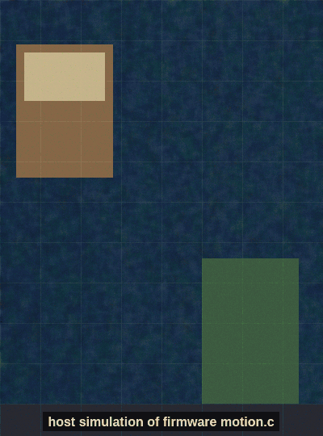
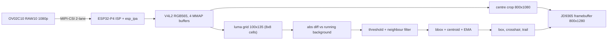
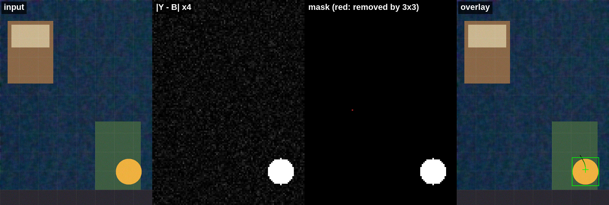
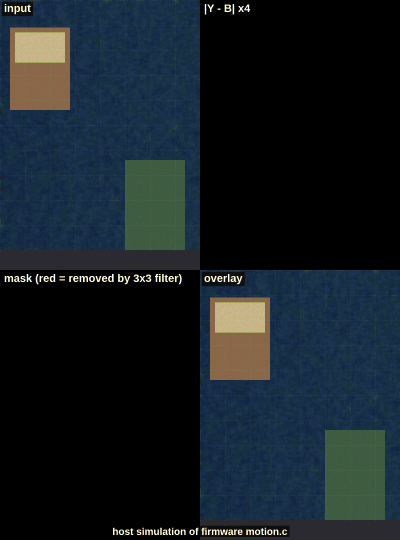
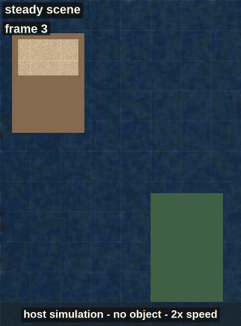
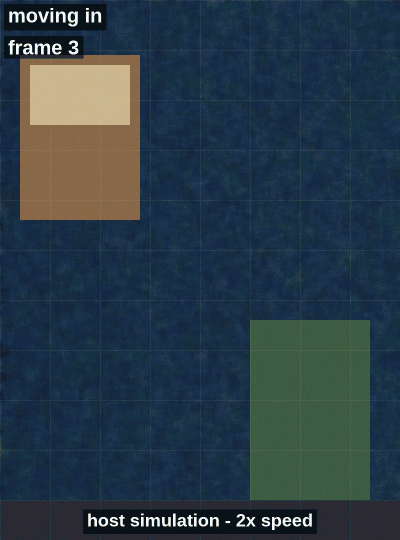
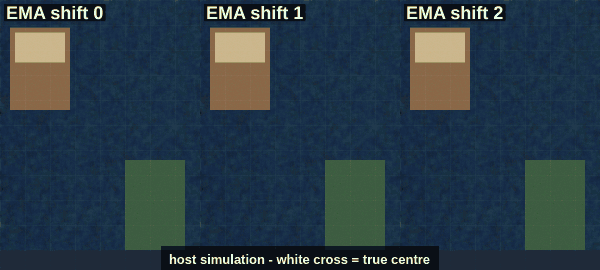

# esp32-p4-motion-cam

Live OV02C10 camera to a 10.1" MIPI-DSI panel on an ESP32-P4 board, with a simple frame-differencing motion tracker drawn on top. Plain ESP-IDF 5.4.4, C, no Arduino.

[](https://github.com/zititank/esp32-p4-motion-cam/actions/workflows/build.yml)


[](#license)

<p align="center">
  
</p>

<p align="center"><em>Host simulation of the firmware's <code>motion.c</code> on a synthetic scene, not a camera recording. The same C file runs on the board. See <a href="#status">Status</a> for what has and hasn't run on hardware.</em></p>

> [!IMPORTANT]
> This is a reference example, not a drop-in firmware. I wrote it for one board, the Guition JC8012P4A1C. ESP32-P4 boards that look alike differ in the details that matter here: I2C pins and port, the camera clock, the panel controller, resolution and refresh timing, and the chip revision. On another board, expect to change constants before you see an image. [docs/PORTING.md](docs/PORTING.md) lists every one and where it lives.

## What it does

- Brings up an OV02C10 sensor (RAW10, 1920x1080, 2-lane MIPI-CSI) through Espressif's `esp_video` / `esp_cam_sensor` stack, with an OV02C10 driver I added.
- Lets the ESP32-P4 ISP turn RAW Bayer into RGB565 and reads frames through a V4L2-style API (4 MMAP buffers).
- Copies a full-height 800x1080 centre crop straight into the framebuffer of the 800x1280 portrait JD9365 panel, with black bars top and bottom.
- Runs a motion detector on a 100x135 luma grid of that crop, and draws a green bounding box, a crosshair at the smoothed centroid and a short trail. A small green square in the top bar shows when motion is active.
- Logs boot diagnostics (I2C scan, sensor chip ID, V4L2 formats and controls), motion time and FPS every 60 frames, and a heap report every 300 frames.

## Hardware

| | |
|---|---|
| Board | Guition JC8012P4A1C (third-party board, not made by Espressif) |
| SoC | ESP32-P4NRW32, pre-v3 silicon on my unit, CPU at 360 MHz |
| Memory | 32 MB PSRAM, 16 MB flash |
| Camera | OV02C10, 2 MP, 2-lane MIPI-CSI, 19.2 MHz XCLK on GPIO6 |
| Display | 10.1" IPS 800x1280 portrait, JD9365, 2-lane MIPI-DSI |
| Also on board, unused here | ESP32-C6 radio, GSL3680 touch, ES8311 audio, RTC |

Pin map and sources: [docs/HARDWARE.md](docs/HARDWARE.md).

## Pipeline



## Motion detection in short

Textbook background subtraction, sized to run every frame on the CPU:

1. Sample one pixel per 8x8 cell of the crop and convert it to luma: $Y = (77R + 150G + 29B) \gg 8$.
2. Compare with a per-cell running-average background $B$: a cell changes if $|Y - B| > 18$.
3. Update $B$ with weight $1/8$ only in unchanged cells; freeze it while a cell is above threshold so movers don't leave ghost trails. After 120 consecutive foreground frames, reset that cell to the current luma (absorbs a stopped object or a lighting step).
4. Keep a changed cell only if at least 3 of its 8 neighbours changed too.
5. Motion is on after 2 consecutive frames with at least 12 kept cells.
6. Bounding box from the kept cell centres, extended by `cell - 1` px on each side (point sampling); centroid from image moments $(m_{10}/m_{00},\ m_{01}/m_{00})$, smoothed with an EMA.

Formulas, parameters, cost, weaknesses and references: [docs/ALGORITHM.md](docs/ALGORITHM.md).



*Host simulation, one frame: input, $|Y - B|$ (x4), mask after the neighbour filter (red cells were removed by it), overlay.*

## Build and flash

You need ESP-IDF **v5.4.4** ([install guide](https://docs.espressif.com/projects/esp-idf/en/v5.4.4/esp32p4/get-started/index.html)). Other 5.4.x versions will probably work but I haven't tried them. ESP-IDF 4.x can't target the ESP32-P4.

```bash
git clone https://github.com/zititank/esp32-p4-motion-cam.git
cd esp32-p4-motion-cam
. $IDF_PATH/export.sh
idf.py set-target esp32p4 && idf.py build flash monitor
```

`set-target` generates `sdkconfig` from `sdkconfig.defaults`, and the component manager downloads `esp_video`, `esp_ipa` and `esp_lcd_jd9365` on the first build. Add `-p /dev/ttyACM0` (or your port) to `flash monitor` if it isn't found.

The log level is INFO. During bring-up I ran with VERBOSE; add `CONFIG_LOG_DEFAULT_LEVEL_VERBOSE=y` to `sdkconfig.defaults` (then delete `sdkconfig` and rebuild) if you want that back.

A good boot shows the I2C scan with a device at 0x36, `Detected Camera sensor PID=0x5602`, a list of V4L2 controls (zero controls means the ISP tuning file didn't load), then `frame N: ...` lines and `motion: avg ... us/frame, ... FPS` every 60 frames.

## Host tests and simulation

The motion detector and the overlay drawing are plain C99, so they also build on a PC:

```bash
make -C test/host          # unit tests
make -C test/host asan     # same, with AddressSanitizer and UBSan
tools/sim/make_all.sh      # needs ffmpeg; regenerates every image in docs/images/ (~80 s)
```

The tests cover a static scene, noise below the threshold, a moving square (box contains it, centroid within one cell), the square leaving, a stopped object absorbed after `MOTION_FG_ABSORB_FRAMES`, API guards and overlay clipping. The simulations render synthetic 800x1080 scenes with ffmpeg (textured background, sensor-like noise, a moving object, brightness changes) and run them through the same `motion.c` and `overlay.c`. Details in [tools/sim/README.md](tools/sim/README.md).

## Simulation gallery

Host simulations of the firmware's `motion.c` on synthetic scenes, not camera footage. The numbers are measured by the simulation; details in [ALGORITHM.md](docs/ALGORITHM.md#simulation-results).

<table>
  <tr>
    <td width="50%" align="center" valign="top">
      <br>
      <b>Pipeline:</b> input, |Y − B| x4, mask and overlay for every frame of the demo scene.
    </td>
    <td width="50%" align="center" valign="top">
      <br>
      <b>Lighting:</b> a +8 luma step is ignored. A +28 step flags the whole frame for 153 frames, until the absorb reset. A 2 Hz flicker gives 69 false-positive frames out of 90.
    </td>
  </tr>
  <tr>
    <td width="50%" align="center" valign="top">
      <br>
      <b>Stop and absorb:</b> a stopped object drops out of detection after 120 frames. When it leaves, a ghost at its old spot stays active for 94 frames.
    </td>
    <td width="50%" align="center" valign="top">
      <br>
      <b>Smoothing:</b> <code>centroid_ema_shift</code> 0 / 1 / 2 lags 0 / 1 / 3 frames (mean error 1.0 / 8.7 / 24.9 px). On this clean scene 1 is as smooth as 2; 2 only helps near the noise limit.
    </td>
  </tr>
</table>

## Tuning knobs

| Knob | Where | Default | What it does |
|---|---|---|---|
| `APP_MOTION_ENABLE` | `main/app_config.h` | 1 | 0 gives the original August 2026 passthrough loop |
| `APP_HEAP_REPORT`, `APP_HEAP_REPORT_EVERY` | `main/app_config.h` | 1, 300 | PSRAM and internal heap log every N frames |
| `APP_SW_GAIN` | `main/app_config.h` | 1 | Diagnostic software gain; above 1 only for looking at an uncalibrated image |
| `LCD_SELFTEST` | `main/app_config.h` | 0 | Solid red, green, blue at boot, to check the panel alone |
| `LCD_MANUAL_DSI_SEQ` | `main/app_config.h` | 0 | Re-send a manual DSI wake-up sequence; normally not needed |
| `motion_cfg_t` fields | `MOTION_CFG_DEFAULT` in `main/motion.h` | cell 8, threshold 18, bg_shift 3, neighbours 3, min cells 12, hysteresis 2, EMA shift 2 | See the parameter table in [ALGORITHM.md](docs/ALGORITHM.md#parameters) |
| `MOTION_BUDGET_US` | `main/app_main.c` | 15000 | If motion plus overlay average more than this per frame, motion switches itself off |
| IPA tuning file | `CONFIG_CAMERA_OV02C10_*_IPA_JSON_CONFIGURATION_FILE` in `sdkconfig.defaults` | `DEFAULT` | `NO_IPA_...=y` gives the uncalibrated August behaviour |

Board pins, clocks and panel timing are in `main/board_jc8012p4a1.h`; see [PORTING.md](docs/PORTING.md).

## Status

- **August 2026, on the board:** the live camera image reached the panel, but uncalibrated. The boot log showed `failed to get configuration to initialize ISP controller` and zero V4L2 controls, and the picture had dark corners and a grey cast. That firmware is kept unchanged in [docs/history/main_original_aug2026.c](docs/history/main_original_aug2026.c).
- **September 2026, not yet on the board:** build fixes, the ISP tuning file enabled (the one intentional runtime change), the split into modules, the motion detector and overlay, host tests, simulation and a CI workflow. None of this has run on the board. It's verified by compiling, host tests and simulation only.
- **Build, September 2026, on my PC:** the firmware builds for the ESP32-P4 with a native ESP-IDF v5.4.4 install, with zero warnings. The app image is 529,232 bytes, so about half of the 1 MB app partition is still free; with `APP_MOTION_ENABLE=0` it's 524,512 bytes. All 391 host test checks pass, plain and with AddressSanitizer/UBSan. Getting there needed one more fix to the ISP tuning file; see the [engineering log](docs/ENGINEERING_LOG.md#ipa-json-crashed-the-esp_ipa-config-generator).
- **Config:** the generated `sdkconfig` matches my August bring-up config on the settings that matter (chip revision, CPU clock, PSRAM, watchdog, sensor and ISP). The one deliberate difference is the log level, INFO instead of VERBOSE.
- **CI:** the workflow in `.github/workflows/build.yml` runs the firmware build, the host tests and the simulation scripts on every push. It hasn't run on GitHub yet, so the badge above stays grey until the first push.

When I have the board on my desk again, the next step is to flash this version, replace the simulated GIF with a real recording, and add the boot log.

## Known issues

- **Image quality.** The ISP tuning file isn't a real calibration (flat lens-shading tables, generic colour matrix, and auto-exposure parameters copied from Espressif's SC2336 file). Expect the vignette to stay even when exposure and white balance work, and auto-exposure may hunt or settle too dark or too bright.
- **No rotation.** The panel shows an 800x1080 centre crop, about 42% of the sensor width. Hardware rotation with the PPA didn't work for me.
- **Tearing.** One framebuffer, no sync with the panel refresh.
- **Bayer order** is unconfirmed (GRBG in the driver; other sources disagree).
- **Lighting.** Lights switching on, flicker and auto-exposure steps look like motion. After a big global change the whole frame can stay "in motion" until the absorb timer (120 frames, about 4 s at 30 fps) resets frozen cells. In the simulation a +28 luma step keeps the whole frame active for 153 frames ([lighting stress](docs/ALGORITHM.md#lighting-stress)).
- **Watchdog.** The task watchdog is set to 20 s with no panic, as a mitigation. There's an unconfirmed theory about the real cause, from reading the code.
- **Licensing of binaries.** The OV02C10 driver is GPL-2.0-only. See [License](#license).

Details on each: [docs/ENGINEERING_LOG.md](docs/ENGINEERING_LOG.md).

## Lessons and open problems

The six things that cost me the most time, written up in [docs/LESSONS_AND_OPEN_PROBLEMS.md](docs/LESSONS_AND_OPEN_PROBLEMS.md):

1. **Watchdog resets** (partly solved): memory layout, a pinned ESP-IDF 5.4.4, building for pre-v3 silicon, and a longer watchdog made it go away, but I can't prove the cause is gone.
2. **PSRAM exhaustion** (solved): 4 MB camera buffers add up fast; drawing straight into the framebuffer and dropping the bounce buffer fixed it.
3. **PPA rotation** (unsolved): the P4's rotation hardware didn't give me a working picture, so the firmware crops.
4. **Don't hand-roll bring-up** (lesson): hand-written register sequences went nowhere; plugging one driver into Espressif's component stack worked.
5. **Light sensitivity** (unsolved): frame differencing sees brightness change, not motion.
6. **Clock mismatch** (solved by using components): 19.2 MHz XCLK against 24 MHz assumptions; a format table that keeps clock, registers and lane rate together fixed it.

## Repository layout

```
main/
  app_main.c            init order and frame loop
  board_jc8012p4a1.h    pins, clocks, panel and camera constants for this board
  app_config.h          crop, letterbox and build switches
  camera.c/.h           esp_video init, V4L2 format, MMAP buffers, DQBUF/QBUF
  display.c/.h          JD9365 DSI panel, backlight, framebuffer, crop copy
  diagnostics.c/.h      I2C scan, V4L2 formats and controls, heap report
  motion.c/.h           motion detector, plain C99 (host-testable)
  overlay.c/.h          RGB565 box, crosshair and trail drawing, plain C99
components/esp_cam_sensor/   Espressif esp_cam_sensor 2.3.0, vendored, plus sensors/ov02c10/
test/host/              unit tests for motion.c and overlay.c (gcc + make)
tools/sim/              synthetic scenes -> motion_sim -> docs/images/ (make_all.sh)
docs/
  HARDWARE.md  ALGORITHM.md  ENGINEERING_LOG.md  LESSONS_AND_OPEN_PROBLEMS.md  PORTING.md  PUBLISH.md
  history/main_original_aug2026.c   the original single-file firmware, unchanged
  images/                           simulation output
.github/workflows/build.yml         firmware build, host tests, simulation smoke run
```

## Credits

- Espressif for ESP-IDF, `esp_video`, `esp_cam_sensor`, `esp_ipa` and `esp_lcd_jd9365`.
- Intel (Hao Yao) and the mainline Linux upstreaming contributors for the OV02C10 Linux driver, which the register table is derived from.
- sukesh-ak, profi-max, LaskaKit and the Home Assistant community for the board documentation I worked from.
- csvke for an independent OV02C10 port for `esp-video-components` (related work, not used here).

Full list with licences and links: [THIRD_PARTY_NOTICES.md](THIRD_PARTY_NOTICES.md).

## AI usage

I used AI coding tools heavily for drafting code, diagnostics and these docs. The hardware work, testing on the board and decisions were mine. What was and wasn't checked: [AI_USAGE.md](AI_USAGE.md).

## License

- My own code (`main/`, `test/`, `tools/`, `.github/`, docs) is under the [MIT License](LICENSE).
- `components/esp_cam_sensor/` is Espressif's code under Apache-2.0, with its original licence file, except for:
- `components/esp_cam_sensor/sensors/ov02c10/`, which is **GPL-2.0-only**, because its register table is derived from Intel's GPL-2.0 Linux driver. The ISP tuning JSON in that folder is the exception; it contains nothing from the Linux driver.
- `esp_video` and `esp_ipa` are downloaded at build time under the ESPRESSIF MIT License, which only permits use on Espressif chips. `esp_ipa` includes prebuilt libraries.

The MIT licence in `LICENSE` does not cover the third-party parts. Because of the GPL-2.0-only driver next to Apache-2.0 code and prebuilt libraries, I don't think a built firmware binary can be redistributed cleanly as it is. Details in [THIRD_PARTY_NOTICES.md](THIRD_PARTY_NOTICES.md#distributing-binaries).
