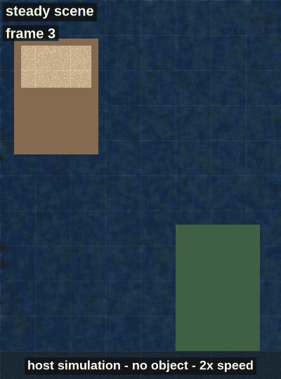
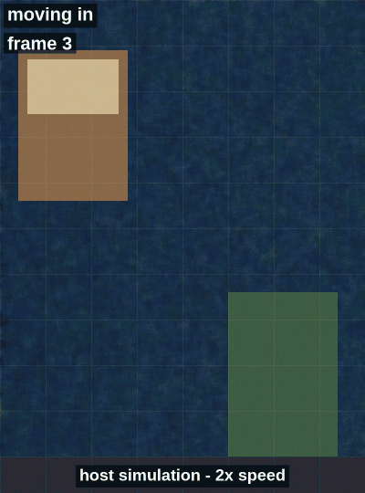
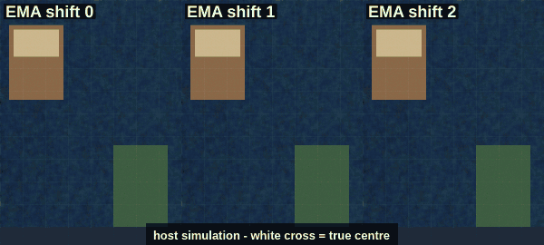

# Motion detection algorithm

The detector in [`main/motion.c`](../main/motion.c) is textbook background subtraction on a coarse luma grid. Nothing here is new. It's the simplest method that runs every frame on the ESP32-P4 CPU next to an 800x1080 copy and can be tested on a PC. The references at the end are the standard sources for each step. I'm citing them so you know where the ideas come from, not because I copied code from any of them.

`motion.c` is plain C99 with no ESP-IDF headers. The firmware, the host tests in `test/host/` and the simulator in `tools/sim/` all compile the same file.

## Input

- One RGB565 camera frame, 1920x1080, with the line pitch reported by V4L2.
- A region of interest (ROI): the same 800x1080 centre crop that goes to the panel (`CROP_W`, `CROP_H`, `CROP_SRC_X`, `CROP_SRC_Y` in `main/app_config.h`).
- A config struct, `motion_cfg_t`, filled from `MOTION_CFG_DEFAULT` in `main/motion.h`.

## Steps

### 1. Luma grid

The ROI is split into square cells of `cell` pixels (default 8). With an 800x1080 ROI that gives a grid of

```math
G_w = \lfloor 800 / 8 \rfloor = 100, \qquad G_h = \lfloor 1080 / 8 \rfloor = 135, \qquad 13{,}500 \text{ cells.}
```

Each cell takes the pixel at its centre (offset `cell/2` in both directions). This is point sampling, not a block average. RGB565 is widened to 8 bits per channel by bit replication:

```math
R_8 = (R_5 \ll 3) \,|\, (R_5 \gg 2), \quad G_8 = (G_6 \ll 2) \,|\, (G_6 \gg 4), \quad B_8 = (B_5 \ll 3) \,|\, (B_5 \gg 2)
```

and converted to luma with the integer form of the BT.601 weights (0.299, 0.587, 0.114 scaled by 256):

```math
Y = (77 R_8 + 150 G_8 + 29 B_8) \gg 8
```

### 2. Difference against the background

For each cell $i$, with $B_{t-1}$ the background from before this frame:

```math
D_t(i) = \lvert Y_t(i) - B_{t-1}(i) \rvert, \qquad M^{raw}_t(i) = [\, D_t(i) > T \,]
```

$T$ is `diff_threshold` (default 18 out of 255).

The very first frame after `motion_init()` or `motion_reset()` only seeds the background ($B = Y$) and reports no motion.

### 3. Background update (freeze + absorb)

The background is a per-cell running average (exponential moving average), the same idea as the adaptive background in Pfinder, with one intentional change for moving objects.

When a cell is **not** above threshold ($M^{raw}_t(i) = 0$), it updates normally:

```math
B_t(i) = B_{t-1}(i) + \frac{Y_t(i) - B_{t-1}(i)}{2^{k_{bg}}}
```

$k_{bg}$ is `bg_shift` (default 3, so a weight of 1/8).

When a cell **is** above threshold, its background is **frozen**: no EMA step that frame. A plain running average let slow-moving objects blend into $B$ and leave ghost trails behind them in the host simulation, so the background is frozen in foreground cells instead.

A frozen cell that stays above threshold for `MOTION_FG_ABSORB_FRAMES` consecutive frames (default **120**) is reset to the current luma:

```math
B_t(i) = Y_t(i) \quad \text{when } r_t(i) \ge 120
```

where $r_t(i)$ is a per-cell counter of consecutive foreground frames (`fg_run` in the work buffer). The counter clears as soon as the cell drops below threshold. That absorb step is how a stopped object or a lighting step stops counting as motion forever. At 30 fps, 120 frames is about 4 s.

The background is stored in 8.8 fixed point (`bg_q8`), and the EMA step is rounded toward zero. With a plain 8-bit `>> 3`, small positive and negative differences round differently, and the background stalls a few levels away from the true value.

### 4. Neighbour filter

A changed cell is kept only if at least `min_neighbors` (default 3) of its 8 neighbours are also changed in $M^{raw}$:

```math
M_t(i) = M^{raw}_t(i) \wedge \Big( \sum_{j \in N_8(i)} M^{raw}_t(j) \ge n_{min} \Big)
```

This removes isolated cells from sensor noise and thin edges. The filter is one pass and reads only $M^{raw}$, so the result doesn't depend on scan order.

### 5. Motion decision with hysteresis

```math
m_{00} = \sum_i M_t(i)
```

A frame counts as a motion frame if $m_{00} \ge$ `min_cells` (default 12). Motion becomes active after `hysteresis_frames` (default 2) consecutive motion frames. It turns off on the first frame below `min_cells`. So the hysteresis only delays switching on; it doesn't hold motion on.

### 6. Bounding box and centroid

Only cell centres are sampled, so a change can sit up to `cell - 1` pixels past the outermost changed sample before the next (unchanged) sample would have caught it. The bounding box therefore extends that far past the min/max kept cell centres, then clamps to the ROI:

```math
\begin{aligned}
x_0 &= g_{x0}\cdot c + c/2 - (c - 1), &
x_1 &= g_{x1}\cdot c + c/2 + (c - 1), \\
y_0 &= g_{y0}\cdot c + c/2 - (c - 1), &
y_1 &= g_{y1}\cdot c + c/2 + (c - 1)
\end{aligned}
```

with $c =$ `cell`, and $(g_{x0}, g_{y0})$, $(g_{x1}, g_{y1})$ the min/max grid indices of cells in $M_t$. Corners are inclusive in ROI pixel coordinates.

The centroid comes from the first-order image moments over the kept cells, using each cell's centre $(x_i, y_i)$ in pixels:

```math
m_{10} = \sum_i M_t(i)\, x_i, \quad m_{01} = \sum_i M_t(i)\, y_i, \qquad
\bar{x} = \frac{m_{10}}{m_{00}}, \quad \bar{y} = \frac{m_{01}}{m_{00}}
```

### 7. Centroid smoothing

The centroid is smoothed with another EMA in 8.8 fixed point:

```math
C_t = C_{t-1} + \frac{(\bar{x}, \bar{y}) - C_{t-1}}{2^{s}}
```

$s$ is `centroid_ema_shift` (default 2, weight 1/4). The EMA restarts from the raw centroid whenever motion drops out.

### 8. Overlay

`main/overlay.c` draws the result into the RGB565 framebuffer before the cache sync (`motion_frame()` in `main/app_main.c`):

- a green bounding box, 3 px lines;
- a crosshair at the smoothed centroid;
- a trail through the last 16 centroids (`OVERLAY_TRAIL_LEN`), older segments dimmer, cleared when motion stops;
- a 24 px square in the top black bar, green while motion is active.

Coordinates are shifted down by the letterbox offset (`LETTERBOX_TOP`, 100 px). Drawing is clipped to the crop area, which the next frame's copy overwrites, so nothing needs erasing.

## Parameters

| Field in `motion_cfg_t` | Default | Meaning | Raise it if | Lower it if |
|---|---|---|---|---|
| `cell` | 8 | Cell size in pixels | CPU time matters more than detail | small objects are missed |
| `diff_threshold` | 18 | Luma change (0-255) that marks a cell | noise or flicker triggers motion | slow or low-contrast objects are missed |
| `bg_shift` | 3 | Background weight $1/2^k$ (unchanged cells only) | the background eats slow movers that never cross $T$ | lighting drift causes false motion |
| `min_neighbors` | 3 | Changed 8-neighbours needed to keep a cell | speckle noise gets through | thin objects vanish |
| `min_cells` | 12 | Kept cells for a motion frame | small noise blobs trigger | small objects are missed |
| `hysteresis_frames` | 2 | Consecutive motion frames before active | single-frame glitches trigger | response is too slow |
| `centroid_ema_shift` | 2 | Centroid weight $1/2^s$ | the crosshair jitters | the crosshair lags |

`MOTION_FG_ABSORB_FRAMES` (120) is a `#define` in `main/motion.h`, not part of the struct. It is how many consecutive foreground frames a cell needs before its background jumps to the current luma.

The grid is `roi_w / cell` by `roi_h / cell`, rounded down, so a cell size that doesn't divide both 800 and 1080 leaves a strip on the right or bottom unchecked. The divisors of both are 1, 2, 4, 5, 8, 10, 20 and 40.

## Cost and memory

- **Pixel reads.** One read per cell, so 13,500 reads per frame out of the 864,000 pixels in the ROI. The camera buffer lives in PSRAM, so the cost is mostly cache misses, not arithmetic.
- **Arithmetic.** $O(G_w G_h)$ per frame for luma, difference, background and moments. The neighbour filter adds at most 8 lookups per changed cell.
- **Memory.** The caller passes one work buffer of `motion_buffer_size()` bytes: a 16-bit background (`bg_q8`) plus six 8-bit planes (rounded background, luma, difference, raw mask, mask, and `fg_run`). That's **8 bytes per cell**, so $13{,}500 \times 8 = 108{,}000$ bytes (about 105 KiB) for the default 800x1080 / 8x8 grid. Each plane on its own is 13,500 bytes. For comparison, one camera frame is 4,147,200 bytes. `motion.c` allocates nothing itself. The firmware puts the buffer in internal RAM if at least 64 KB of internal RAM stays free afterwards, and in PSRAM otherwise.
- **Debug views.** After a processed frame, `motion_luma`, `motion_background`, `motion_diff`, `motion_mask_raw` and `motion_mask` return pointers into those planes (grid width × height, row-major). The host simulation uses them for the 4-panel PNG and GIF.
- **Timing.** The firmware logs the average motion-plus-overlay time and the loop FPS every 60 frames using `esp_timer`. If the average goes above 15 ms (`MOTION_BUDGET_US`), it turns motion off and logs a warning, so the camera view keeps its frame rate. I don't have the numbers from the board yet (see the README status section).

## Known weaknesses

Frame differencing measures change in brightness, not motion. Anything that changes brightness looks like motion. More about this, and what I'd try next, is in [LESSONS_AND_OPEN_PROBLEMS.md](LESSONS_AND_OPEN_PROBLEMS.md#5-light-sensitivity-of-frame-differencing).

- **Global lighting changes.** A light switched on changes almost every cell at once. Frozen cells stay "in motion" until `MOTION_FG_ABSORB_FRAMES` (120) consecutive foreground frames reset them, about 4 s at 30 fps. That's better than waiting for a slow EMA to catch up, but the whole frame still looks active for those four seconds. A simple fix I haven't implemented: if more than some fraction of the grid changes in one frame, call `motion_reset()` and re-seed.
- **Auto-exposure and white balance steps.** With the IPA tuning file loaded, AE and AWB move the whole image in steps. That's a smaller version of the same problem.
- **Flicker.** Mains-powered lights flicker at 100 or 120 Hz. At 30 fps that can alias into slow brightness waves.
- **Shadows and reflections** count as motion, because they change luma.
- **Stopped objects** stay active until the absorb timer fires (120 frames by default), then snap into the background. They do not fade gradually.
- **One box for everything.** Two people moving in different corners get one big box around both. There's no connected-component labelling.
- **Small objects.** A line one cell wide has at most 2 changed neighbours per cell, so the neighbour filter removes it. A blob also needs 12 kept cells, for example 4x3 cells (32x24 px), before it counts.
- **Point sampling** can alias on fine textures: a small shift of a striped pattern can flip many samples at once.
- **Colour is ignored.** A change in hue at equal luma is invisible.

Several of these are measured on synthetic scenes in the next section.

## Simulation results

All numbers come from `tools/sim/make_all.sh` ([tools/sim/README.md](../tools/sim/README.md)): synthetic 800x1080 scenes rendered with ffmpeg and run through this `motion.c` with `MOTION_CFG_DEFAULT`. The scenes are easy compared to a real camera: a rigid, evenly coloured object, a static background and uniform noise. Treat them as a check of the mechanics and a best case, not as a claim about the board. `tools/sim/out/results.txt` has the raw output.

### Tracking

The demo scene (the README GIF): 15 fps, 120 frames, object in view from frame 15. Motion is active in 104 of the 105 frames with the object (the one miss is the hysteresis frame) and in none of the 15 frames before it. Centroid error: mean 24.9 px, worst 38.2 px. Almost all of that is smoothing lag: the best-fit lag is 3 frames, and at that delay only 2.7 px of error is left.

### Lighting stress



30 fps, 420 frames, no object, so every active frame is a false positive. The mean luma of the grid is in brackets.

| Segment | Frames | Active | What happens |
|---|---|---|---|
| steady (56.6) | 0-29 | 0 of 30 | |
| +8 luma step (64.9) | 30-89 | 0 of 60 | Below the threshold of 18 everywhere; the background EMA soaks it up. |
| +28 luma step (92.6) | 90-269 | 153 of 180, frames 91-243 | 13,333 of 13,500 cells flip at once and the box is the whole frame. Kept cells leak out slowly as noise dips reset them (13,318 → 5,411 by frame 209). The absorb reset at frame 210, 120 frames after the step, drops them to 255, and the rest drain by frame 243. |
| 2 Hz brightness wave (70.9-116.0) | 270-359 | 69 of 90 | Cells cross the threshold every half cycle. Each dip back under it resets that cell's absorb counter, so the timer never fires. |
| steady (92.6) | 360-419 | 0 of 60 | |

Recovery time depends on how far above the threshold the step is. The same scene with a +24 luma step instead of +28 is active for 62 frames (91-152): with the difference closer to the threshold, noise pushes more cells under it, and the EMA catches up before the absorb timer is needed.

### Stop and absorb



30 fps, 420 frames:

- The object slides in from frame 15. Motion is active from frame 18.
- It stops at frame 60 and stays boxed until frame 179. The last cells to go are its leading edge, which it covered last; each cell needs its own 120 frames.
- Frames 180-239: the object stands in plain view and isn't detected. That's the absorb step doing what it's meant to.
- From frame 240 it moves away. Its old spot now differs from the background, which holds the object's colour, so the box spans the ghost and the moving object.
- The object is out of view after frame 274, but the ghost stays active for 94 more frames, until frame 368, when the absorb timer fires again.

So a parked object that leaves again causes about 4 s of false motion at the spot where it stood. The fix would be the same as for lighting: notice when a large region changes together and re-seed it.

### Centroid smoothing



The demo scene with `centroid_ema_shift` 0, 1 and 2, and with more sensor noise. Each cell is mean error / best-fit lag / jitter (see [tools/sim/README.md](../tools/sim/README.md#motion_sim) for the definitions). Noise is given as the mean $\lvert Y - B\rvert$ on the empty scene.

| Noise | shift 0 | shift 1 | shift 2 (default) |
|---|---|---|---|
| 3.1 (demo) | 1.0 px / 0 fr / 1.86 px | 8.7 px / 1 fr / 1.11 px | 24.9 px / 3 fr / 1.16 px |
| 6.5 | 1.4 px / 0 fr / 2.74 px | 8.9 px / 1 fr / 1.44 px | 25.0 px / 3 fr / 1.36 px |
| 7.6 | 9.7 px / 0 fr / 14.24 px | 13.5 px / 1 fr / 5.50 px | 27.3 px / 3 fr / 2.73 px |

The lags match what an EMA does on a steady ramp: weight $1/2^s$ lags by $2^s - 1$ frames, so 0, 1 and 3.

With clean input, shift 1 already removes most of the jitter shift 0 has, and shift 2 adds only lag (three times as much). With noise near the breakdown point (7.6), stray noise clusters pull the raw centroid around, and shift 2 halves the jitter of shift 1. A rigid disc of one colour is the easy case for a centroid; a hand changes shape every frame. So the default stays at 2 until jitter can be measured on real camera frames. If the board shows little jitter, 1 is the better setting.

### Threshold against sensor noise

A 10 s empty scene followed by the demo object, at five noise levels and three thresholds. Each cell is the number of false-positive frames out of the 150 empty ones. 148 means every frame after seeding and hysteresis.

| Noise, mean $\lvert Y - B\rvert$ | T = 12 | T = 18 (default) | T = 24 |
|---|---|---|---|
| 3.1 | 0 | 0 | 0 |
| 6.5 | 148 | 3 | 0 |
| 7.6 | 148 | 19 | 0 |
| 11.2 | 148 | 148 | 122 |
| 17.7 | 148 | 148 | 148 |

The object (high contrast) was missed in at most 1 of 105 frames in every run. Failure is a cliff, not a slope. Once single noisy cells are common enough that a cell often has 3 flagged neighbours at the same time, the neighbour filter stops helping and the whole frame lights up. For this noise the default threshold works up to a mean $\lvert Y - B\rvert$ of about 6.5, roughly a third of the threshold, and T = 24 buys one more step. The real sensor's noise after the ISP is one of the first things to measure on the board.

## References

The method is standard. These are the usual references for each part.

1. R. Jain and H.-H. Nagel, "On the analysis of accumulative difference pictures from image sequences of real world scenes," *IEEE Transactions on Pattern Analysis and Machine Intelligence*, vol. 1, no. 2, pp. 206-214, 1979. (Difference images for detecting moving objects.)
2. C. R. Wren, A. Azarbayejani, T. Darrell and A. P. Pentland, "Pfinder: real-time tracking of the human body," *IEEE Transactions on Pattern Analysis and Machine Intelligence*, vol. 19, no. 7, pp. 780-785, 1997. (Adaptive running-average background.)
3. M. Piccardi, "Background subtraction techniques: a review," *Proc. IEEE International Conference on Systems, Man and Cybernetics*, 2004, pp. 3099-3104. (Survey; running average is the baseline method there.)
4. M.-K. Hu, "Visual pattern recognition by moment invariants," *IRE Transactions on Information Theory*, vol. 8, no. 2, pp. 179-187, 1962. (Image moments $m_{00}$, $m_{10}$, $m_{01}$.)
5. ITU-R Recommendation BT.601, "Studio encoding parameters of digital television for standard 4:3 and wide-screen 16:9 aspect ratios." (Luma weights 0.299, 0.587, 0.114.)
6. OpenCV documentation: [`absdiff`](https://docs.opencv.org/4.x/d2/de8/group__core__array.html), [`threshold`](https://docs.opencv.org/4.x/d7/d1b/group__imgproc__misc.html), [`boundingRect` and `moments`](https://docs.opencv.org/4.x/d3/dc0/group__imgproc__shape.html). (The same pipeline as desktop calls.)
7. Espressif ESP-VISION, image API including `image.difference`: <https://docs.espressif.com/projects/esp-vision/en/latest/esp32p4/api-reference/image.html>. (Espressif's own frame differencing for the P4.)
8. S. Salerno (Eloquent Arduino), "ESP32 cam motion detection": <https://salernosimone.com/en/blog/esp32-cam-motion-detection>. (Block-based downscale-and-diff on a much smaller ESP32. Same idea at a smaller scale.)
