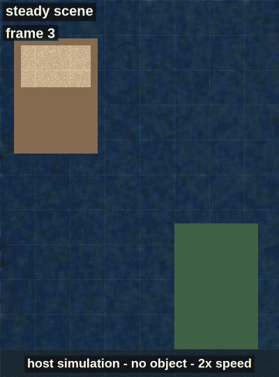

# Lessons and open problems

These are the six problems that cost me the most time on this board. Some are solved, some aren't. Smaller bugs (build errors, a filename typo, the stride bug) are in [ENGINEERING_LOG.md](ENGINEERING_LOG.md).

Status tags:

- **Solved**: fixed, and I know why.
- **Partly solved**: it stopped happening, but I can't prove the root cause is gone.
- **Unsolved**: still open; there's a workaround or nothing.

A note on evidence: most of the hardware work happened in August 2026. I kept the final `sdkconfig` and the source with its comments (now in `docs/history/main_original_aug2026.c`), but not every crash log. Where I don't have a log, I say so.

| # | Problem | Status |
|---|---|---|
| 1 | [Watchdog resets stalling the pipeline](#1-watchdog-resets-stalling-the-pipeline) | Partly solved |
| 2 | [PSRAM exhaustion](#2-psram-exhaustion) | Solved |
| 3 | [PPA 90-degree rotation not working](#3-ppa-90-degree-rotation-not-working) | Unsolved |
| 4 | [Don't hand-roll low-level bring-up](#4-lesson-dont-hand-roll-low-level-bring-up) | Lesson |
| 5 | [Light sensitivity of frame differencing](#5-light-sensitivity-of-frame-differencing) | Unsolved |
| 6 | [Sensor clock mismatch](#6-sensor-clock-mismatch) | Unsolved by hand, fixed by using components |

---

## 1. Watchdog resets stalling the pipeline

**Status: Partly solved**

### What happened

While the camera pipeline was running, the board kept hitting the task watchdog. The stream would stall and the chip would reset. I don't have those boot logs anymore. What I do have is the configuration I ended up with, which is in `sdkconfig.defaults` now.

### What I tried

Several things at once, which is part of why I can't say which one mattered:

- **Memory layout.** Big buffers go to PSRAM. Small allocations stay in internal RAM, and some internal RAM is kept free for DMA and drivers:

  ```
  CONFIG_SPIRAM_USE_MALLOC=y
  CONFIG_SPIRAM_MALLOC_ALWAYSINTERNAL=16384   # allocations up to 16 KB stay internal
  CONFIG_SPIRAM_MALLOC_RESERVE_INTERNAL=32768 # keep 32 KB internal free
  ```

- **Less work per frame.** I removed a 2 MB bounce buffer and the full-screen copy through it. Frames are now drawn straight into the DPI framebuffer (see [problem 2](#2-psram-exhaustion)).
- **A pinned, older ESP-IDF.** I moved from a newer ESP-IDF down to **5.4.4** and pinned the components (`esp_video` 2.3.0, `esp_lcd_jd9365` 2.0.2, `esp_cam_sensor` 2.3.0). Going back to ESP-IDF 4.4 was never an option: 4.x can't target the ESP32-P4 at all. P4 support only arrived in the 5.x line.
- **Building for the right silicon.** My board has a pre-v3 ESP32-P4 (revision below v3.0), so the build targets that instead of the v3 default:

  ```
  CONFIG_ESP32P4_SELECTS_REV_LESS_V3=y
  CONFIG_ESP32P4_REV_MIN_1=y            # REV_MIN_FULL=1, i.e. minimum revision v0.1
  CONFIG_ESP_DEFAULT_CPU_FREQ_MHZ_360=y
  ```

- **A longer, non-fatal watchdog.** This is a mitigation, not a fix:

  ```
  CONFIG_ESP_TASK_WDT_TIMEOUT_S=20
  # CONFIG_ESP_TASK_WDT_PANIC is not set
  ```

### Result

With all of that, the stream ran in August 2026. But with a 20 s timeout and no panic, a stall gets logged instead of rebooting the chip. So "no more resets" doesn't prove the cause is gone. That's why this is only partly solved.

### What I'd do next

A re-read of the frame loop while preparing this repo points to a likely cause. It hasn't been confirmed on hardware yet:

- `app_main` runs at priority 1 on CPU0. The V4L2 node is opened with `O_NONBLOCK`, and the loop only yields (`vTaskDelay(2 ms)`) when `VIDIOC_DQBUF` returns `EAGAIN`.
- If one frame takes longer to process than the camera frame interval, there's always a buffer waiting. The loop then never blocks, the idle task on CPU0 never runs, and the task watchdog fires (`CONFIG_ESP_TASK_WDT_CHECK_IDLE_TASK_CPU0=y`).
- The motion detector adds work to every frame, so this is more likely now than it was in August. It switches itself off above 15 ms per frame (`MOTION_BUDGET_US`), which limits the damage, but the crop copy and cache sync have never been timed on their own.

The test is:

1. Make the loop block or yield once per frame: open the node without `O_NONBLOCK`, or call `vTaskDelay(1)` after each frame.
2. Put the watchdog back to the default 5 s with panic enabled.
3. If it runs for an hour like that, the real cause is found and the mitigation can go.

---

## 2. PSRAM exhaustion

**Status: Solved**

### What happened

Allocations for the camera and display buffers failed or left no room for the rest of the system. The numbers explain why. At 1920x1080 RGB565:

| Buffer | Size |
|---|---|
| One V4L2 capture buffer | 1920 x 1080 x 2 = 4,147,200 B |
| Four of them (`NUM_V4L2_BUFFERS`) | 16,588,800 B |
| DPI framebuffer, 800 x 1280 x 2 | 2,048,000 B |
| The old bounce buffer (removed) | about 2 MB |

That's about 20 MB of 32 MB before the drivers allocate their own internal buffers, which I didn't measure. Fragmentation made it worse: the largest free block matters more than the total free.

### What I tried

- Heap checks around every big allocation, comparing PSRAM and internal RAM: `heap_caps_get_free_size()`, `heap_caps_get_largest_free_block()` and, in earlier versions of the code, full dumps with `heap_caps_print_heap_info()`.
- Checking there was headroom before allocating, instead of finding out from a failed `malloc`.
- Slimming the camera-to-screen path:
  - four MMAP buffers owned by the V4L2 driver, with no extra copies of them;
  - one DPI framebuffer (`dpi_config.num_fbs = 1`);
  - no 2 MB bounce buffer and no full-frame copy through it. The crop is `memcpy`'d row by row straight into the framebuffer (`display_draw_crop()` in `main/display.c`).

### Result

After these changes the allocations succeed and the stream runs. The firmware keeps a light version of the checks: with `APP_HEAP_REPORT` set to 1 in `main/app_config.h`, `diag_heap_report()` logs free and largest-free-block for PSRAM and internal RAM every `APP_HEAP_REPORT_EVERY` (300) frames. If the numbers drift down over time, that's a leak.

### What I'd do next

Record the first heap report after `camera_init()` on the board and put the real numbers in this section. The motion work buffer (108,000 B, about 105 KiB, in internal RAM if 64 KB would still be free, otherwise in PSRAM) is new since August, so the budget should be re-checked anyway.

---

## 3. PPA 90-degree rotation not working

**Status: Unsolved**

### What happened

The camera is landscape (1920x1080) and the panel is portrait (800x1280). To use the whole sensor, the frame has to be turned 90 degrees. The ESP32-P4 has hardware for this: the Pixel-Processing Accelerator (PPA). Its scale-rotate-mirror (SRM) operation, through `esp_driver_ppa`, can rotate and scale in one pass.

### What I tried

I tried a PPA SRM operation to rotate the camera frame by 90 degrees for the panel. I didn't get a working picture out of it. That attempt isn't in the snapshot I kept, and I don't have its error output, so I can't say more precisely what went wrong.

### Result

The firmware doesn't rotate. It takes a full-height 800x1080 centre crop and letterboxes it with 100 px black bars. That shows only 800 of the 1920 sensor columns, about 42% of the field of view.

Even with rotation working, a rotated frame is 1080x1920, which doesn't fit 800x1280. It would also need scaling, for example by 2/3 to 720x1280. SRM can do both in one call, so a working PPA path would show the whole field of view.

### What I'd do next

- Check the buffer requirements first: input and output buffers aligned to the cache line, sizes aligned to match, and the right cache sync before and after (`esp_cache_msync`). Misaligned buffers are the usual reason DMA engines produce garbage or fail.
- Start from the PPA example that ships with ESP-IDF (`examples/peripherals/ppa/`), get it running on this board unchanged, then change one thing at a time towards the camera path.
- If the PPA still fails, rotate in software, but only on a downscaled image. Or rotate only the motion grid and overlay coordinates, which is trivial.

---

## 4. Lesson: don't hand-roll low-level bring-up

**Status: Lesson**

### What happened

At first I tried to bring the camera up by hand: init sequences written register by register over SCCB, and sensor blocks turned on and off one at a time to see what changed. It was slow and fragile. Every failure looked the same, a black or garbage screen. I couldn't tell whether the sensor, the CSI receiver, the ISP or the display was at fault.

### What I tried

I moved to Espressif's component stack and plugged into it instead of replacing it:

- `esp_video`: V4L2-style interface over the MIPI-CSI receiver and the ISP.
- `esp_cam_sensor`: the sensor driver framework. It handles detection by chip ID and holds a format table with the register list, XCLK, lane count and lane rate together.
- `esp_ipa`: the ISP tuning (auto-exposure, white balance, colour) driven by a per-sensor JSON.
- `esp_lcd_jd9365`: the panel driver.

For the OV02C10, which `esp_cam_sensor` doesn't support, I only had to write one driver: a register table, a chip ID check and a format table.

### Result

That's the version where the live image reached the panel. It's also why the repo looks the way it does:

- `main/` only contains application code.
- `components/esp_cam_sensor/` is the upstream component, vendored with one added driver.
- The boot diagnostics check each layer on its own: the I2C scan, then the chip ID, then V4L2 formats and controls, then raw pixel values from the first frames.

### What I'd do next

Next time I'd start from the closest sensor the framework already supports, copy its driver structure, and only replace the register table and chip ID. And I'd write the diagnostics before the feature, not after.

---

## 5. Light sensitivity of frame differencing

**Status: Unsolved**

### What happened

Frame differencing reacts to any change in brightness, not only to movement. Lights switching on, mains flicker, auto-exposure steps and shadows all show up as motion, with boxes appearing where nothing moved.

### What I tried

The current code has these partial mitigations (details in [ALGORITHM.md](ALGORITHM.md)):

- a running-average background instead of the previous frame, so slow drift is absorbed;
- a threshold of 18/255 on the difference;
- a 3x3 neighbour filter that drops isolated changed cells;
- 2-frame hysteresis before motion switches on;
- freezing the background in cells that are currently above threshold, so moving objects don't leave ghost trails;
- after `MOTION_FG_ABSORB_FRAMES` (120) consecutive foreground frames, resetting that cell to the current luma, so a stopped object or a lighting step doesn't stay "moving" forever.

The freeze has a cost. After a global lighting change, the whole frame stays "in motion" until the absorb timer fires (about 4 s at 30 fps), then the background snaps to the new levels.

### Result

It's fine for a steady indoor scene and bad for changing light. I haven't tested this on the board with the motion code yet. The host simulation puts numbers on it for a synthetic scene with no object in it, so every detection is false ([details](ALGORITHM.md#lighting-stress)):



- A +8 luma step: no false positives. The background average absorbs it.
- A +28 luma step: 13,333 of 13,500 cells flip at once and the whole frame is "motion" for 153 frames (about 5 s at 30 fps). Most cells only clear when the absorb timer fires, 120 frames after the step.
- A +24 luma step: 62 false-positive frames. How long it lasts depends on how close the step is to the threshold, which makes it hard to predict.
- A 2 Hz brightness wave (about ±22 luma): 69 false-positive frames out of 90. The absorb timer never fires, because every dip under the threshold resets it.

Real light changes aren't this clean (auto-exposure reacts, shadows move), so this is closer to a best case.

### What I'd do next

In rough order of effort:

- Detect a global change: if more than some fraction of the grid changes in one frame, re-seed the background with `motion_reset()` instead of reporting motion.
- Normalise each frame by its global mean luma before differencing, so a uniform brightness change cancels out.
- Hold auto-exposure and white balance once they settle, if the V4L2 controls allow it.
- Use a finer grid or a higher-resolution luma source.
- Train a small model on the P4 (for example with ESP-DL), with lighting changes deliberately injected into the training data so it learns to ignore them.

---

## 6. Sensor clock mismatch

**Status: Unsolved when I tried by hand; fixed by using the component stack**

### What happened

The board feeds the camera a 19.2 MHz clock (XCLK) on GPIO6, generated by the LEDC peripheral. Many OmniVision modules and register tables assume 24 MHz. The sensor's PLL multiplies XCLK to get the pixel clock and the MIPI bit rate, so a table written for 24 MHz and fed 19.2 MHz produces a lane rate the CSI receiver isn't configured for. The result is no frames or corrupt frames.

### What I tried

I tried to fix it by hand-tuning the PLL registers to get the lane rate I wanted from 19.2 MHz. I couldn't make it work.

### Result

Two things made it tractable:

- The Intel Linux driver that the register table comes from is written for a 19.2 MHz clock. Mainline Linux defines `OV02C10_MCLK` as 19200000, which is common on laptop camera platforms. So the table and this board agree.
- In `esp_cam_sensor`, the format table keeps `.xclk = 19200000` and `.mipi_info.mipi_clk = 800000000` next to the registers. The clock, the sensor PLL settings and the CSI receiver rate are one object, so they can't drift apart the way my hand-written pieces did.

With that table the stream came up. `XCLK_FREQ_HZ` in `main/board_jc8012p4a1.h` must match `.xclk` in the driver; the board header says so.

### What I'd do next

Two questions are still open, and I haven't checked either:

- **XCLK quality.** LEDC probably can't make an exact 19.2 MHz square wave from its usual source clocks (40 MHz crystal, 80 MHz PLL) with an integer divider. It uses a fractional divider, which gives the right average frequency with cycle-to-cycle jitter. The sensor seems to tolerate it, but I'd like to look at it on a scope.
- **Timing fields.** The driver's ISP info says `pclk = 160 MHz`, `hts = 1140`, `vts = 2328`, `tline_ns = 7125`. Mainline Linux uses HTS 2280 (in pixels) for the same mode at the same 160 MHz pixel rate with 2 lanes, which gives 30 fps. With 1140, $160\,\text{MHz} / (1140 \times 2328)$ comes out at about 60 fps. So 1140 is probably the register value in 2-pixel units, and `tline_ns` may be half the real line time. If `esp_ipa` uses `tline_ns` to convert exposure, auto-exposure could be off by a factor of 2.
